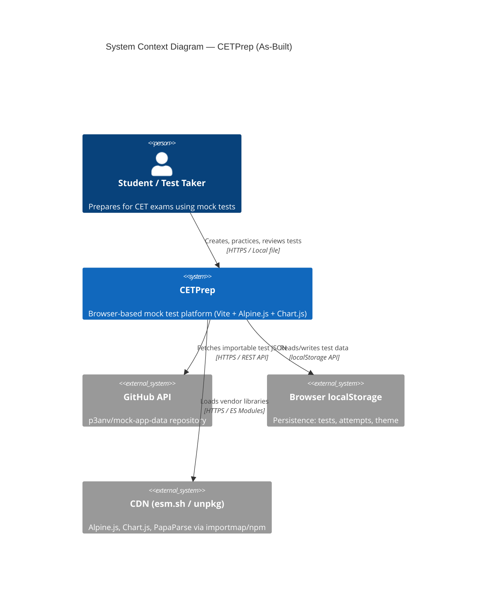
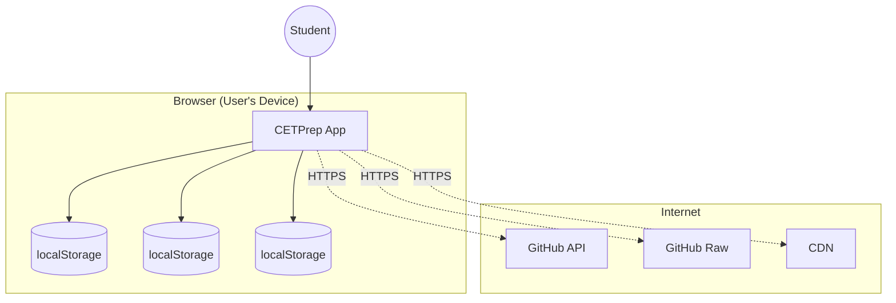

# CETPrep — System Context (C4 Level 1)

## Context Diagram



## Actors

| Actor | Type | Description |
|-------|------|-------------|
| **Student / Test Taker** | Primary | Creates custom tests, takes timed exams, reviews history, imports pre-built tests |
| **Browser** | Runtime | Provides `localStorage`, `fetch`, ES modules, Canvas API, `navigator.clipboard` |

## External Systems

| System | Purpose | Protocol | Auth | SLA / Reliability | Failure Behavior |
|--------|---------|----------|------|-------------------|------------------|
| **GitHub API** (`api.github.com`) | Lists JSON test files in `p3anv/mock-app-data` repo folders | HTTPS REST (v3) | None (public repo, unauthenticated, 60 req/hr rate limit) | Best-effort; no SLA | Import page shows error toast; user can retry; cached folder state persists |
| **GitHub Raw** (`raw.githubusercontent.com`) | Serves raw JSON content for selected test files | HTTPS GET | None | Best-effort | Import fails with toast; user sees error message |
| **Browser localStorage** | Persistent key-value store for all app data | Web Storage API | N/A (same-origin) | Browser-dependent (5–10 MB quota) | QuotaExceededError caught silently; data loss possible |
| **CDN (npm/esm.sh)** | Serves Alpine.js, Chart.js, PapaParse as ES modules | HTTPS | None | Varies by provider | Build fails; dev server fails; cached `node_modules` works offline |

## Data Flows (High-Level)

```mermaid
flowchart LR
    Student[Student] -->|1. Create Test\n(JSON paste/upload)| CETPrep
    Student -->|2. Start Attempt| CETPrep
    CETPrep -->|3. Read/Write Tests| LS[(localStorage\ncet_mock_tests_v3)]
    CETPrep -->|4. Read/Write Attempts| LA[(localStorage\ncet_test_attempts)]
    CETPrep -->|5. Read/Write Theme| LT[(localStorage\ncetprep-theme)]
    CETPrep -->|6. Fetch Folder List| GH_API[GitHub API\n/repos/p3anv/mock-app-data/contents/]
    GH_API -->|7. File List| CETPrep
    CETPrep -->|8. Fetch Test JSON| GH_RAW[GitHub Raw\n/raw.githubusercontent.com/...]
    GH_RAW -->|9. Question Data| CETPrep
    CETPrep -->|10. Export CSV| Student
    CETPrep -->|11. Load Vendor Libs| CDN[CDN\nAlpine/Chart/PapaParse]
```

## Trust Boundaries



| Boundary | Description | Controls |
|----------|-------------|----------|
| **App ↔ localStorage** | Same-origin, trusted | Browser enforces same-origin policy; 5–10 MB quota |
| **App ↔ GitHub API** | Untrusted external | No auth; rate-limited; CSP `connect-src` allows GitHub; JSON parsed via `response.json()` |
| **App ↔ CDN** | Untrusted external | `script type="module"` with integrity not used (npm deps bundled by Vite); vendor code executes in app origin |

## Failure Modes

| Scenario | Impact | Mitigation |
|----------|--------|------------|
| GitHub API rate limited (60/hr) | Import page cannot load folder lists | Cache `folderTests` in Alpine state; user can retry; show `lastSyncTime` |
| GitHub Raw fails / repo deleted | Import fails for specific tests | Toast error; user can create tests manually |
| localStorage quota exceeded | Cannot save new tests/attempts | Silent catch in `storage.js`; no user notification (gap) |
| CDN unavailable | Dev server fails; production build works (vendored) | `node_modules` cached; `dist/` self-contained |
| Browser storage cleared | All user data lost | No backup mechanism (gap); export CSV as manual backup |

---

## Related Documents

- [Overview](overview.md) — Business context and scope
- [Architecture](01-architecture/architecture.md) — C4 L2/L3, module boundaries, internal flows
- [Integrations](01-architecture/integrations.md) — External dependency deep dive
- [Data Model](01-architecture/data-model.md) — Entities stored in localStorage
- [Threat Model](05-security/threat-model.md) — STRIDE analysis