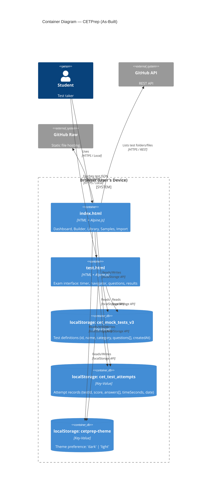
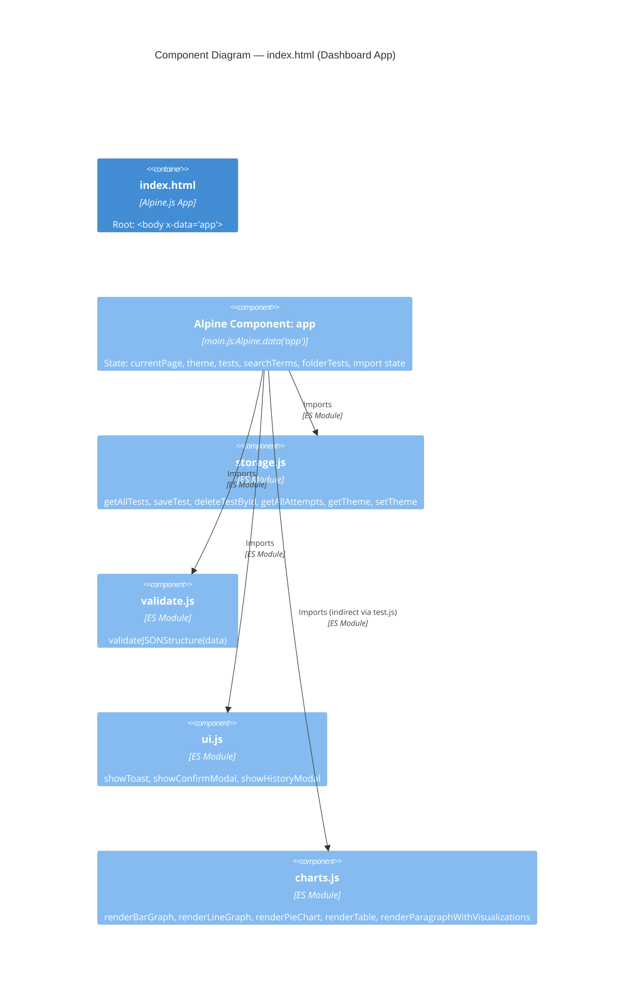
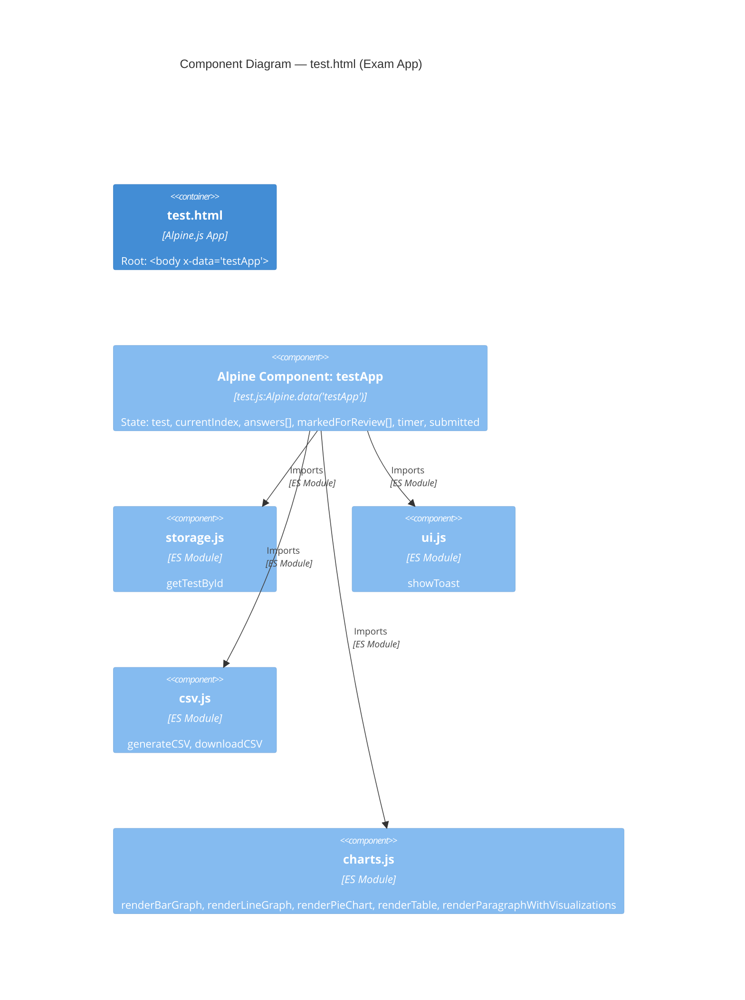
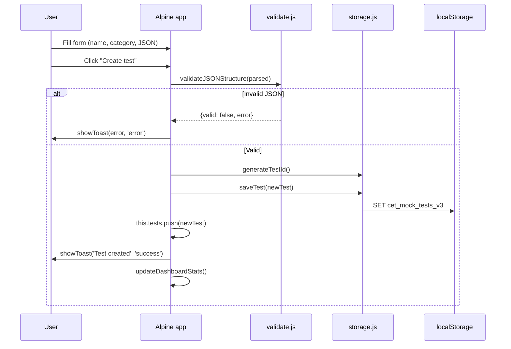
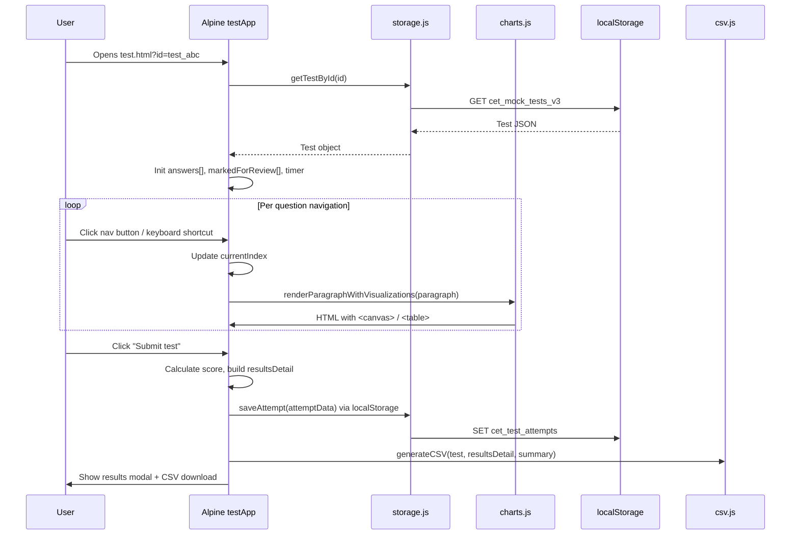
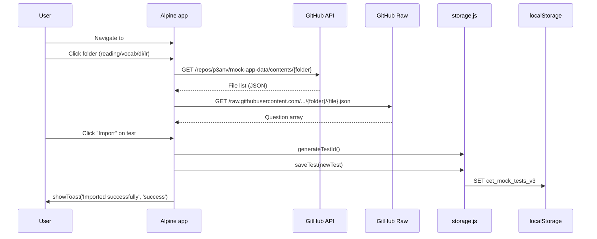

# CETPrep — Architecture (As-Built)

## C4 Level 2 — Container Diagram

## C4 Level 3 — Component Diagram (index.html / main.js)

## C4 Level 3 — Component Diagram (test.html / test.js)

---

## Module Boundaries & Responsibilities

| Module | Exports | Responsibility | Consumers |
|--------|---------|----------------|-----------|
| `storage.js` | `getAllTests, getTestById, saveTest, deleteTestById, getAllAttempts, getAttemptsForTest, saveAttempt, generateTestId, getTheme, setTheme, STORAGE_KEYS` | All `localStorage` CRUD; key constants | `main.js`, `test.js`, `ui.js` |
| `validate.js` | `validateJSONStructure(data)` | Validates test JSON: array, 5 options, correct 0-4, explanation, paragraph string, chart data numbers | `main.js` (Create Test) |
| `charts.js` | `renderBarGraph, renderLineGraph, renderPieChart, renderTable, renderParagraphWithVisualizations, destroyChart` | Chart.js wrappers + paragraph parser for `[BARGRAPH]`/`[LINEGRAPH]`/`[PIEGRAPH]`/`[TABLE]` | `test.js` (exam), `main.js` (import preview - indirect) |
| `csv.js` | `generateCSV(test, resultsDetail, summary), downloadCSV(content, filename)` | PapaParse CSV generation + blob download | `test.js` (results export) |
| `ui.js` | `showToast, showConfirmModal, showHistoryModal` | Reusable modal/toast utilities (DOM-based, not Alpine) | `main.js`, `test.js` |
| `main.js` | `Alpine.data('app')`, `Alpine.data('toast')` | Dashboard, Create, My Tests, Samples, Import pages; hash routing; GitHub import | `index.html` |
| `test.js` | `Alpine.data('testApp')` | Exam interface: timer, navigator, answers, mark-for-review, shortcuts, results modal | `test.html` |

---

## Request / Data Flows

### 1. Create Test Flow

### 2. Take Test Flow

### 3. Import from GitHub Flow

---

## Sync vs Async

| Operation | Sync/Async | Details |
|-----------|------------|---------|
| `localStorage` reads/writes | **Sync** (blocking) | `localStorage.getItem/setItem` — synchronous API |
| `fetch` to GitHub API/Raw | **Async** | `await fetch()` in `main.js:loadFolderTests()`, `importTest()` |
| Chart.js rendering | **Async** (microtask) | `setTimeout(() => renderX(), 0)` in `charts.js:renderParagraphWithVisualizations()` |
| Alpine `$nextTick` | **Async** (microtask) | Used in `test.js` for chart rendering after DOM update |
| Timer `setInterval` | **Async** (macrotask) | 1-second tick in `test.js:startTimer()` |
| CSV blob download | **Sync** | `URL.createObjectURL` + `link.click()` |

---

## Failure Modes

| Component | Failure Scenario | Current Handling | Gap |
|-----------|------------------|------------------|-----|
| `localStorage` | QuotaExceededError (5-10 MB) | `try/catch` in `storage.js` returns `[]` / silent fail | No user notification; data loss silent |
| `localStorage` | Corrupted JSON | `try/catch` in `getAllTests()` returns `[]` | App recovers with empty state |
| GitHub API | Rate limit (60 req/hr unauth) | No retry/backoff; shows error toast | User must wait/retry manually |
| GitHub API | 404 / repo moved | Error toast with message | Import unavailable |
| GitHub Raw | Network error / CORS | Error toast | Import fails |
| Chart.js | Canvas not ready | `waitForParagraphBox` + `$nextTick` + `setTimeout` retry | Robust but complex |
| Chart.js | Destroy previous instance | `destroyChart(canvasId)` via `Map` | Works |
| Alpine | Component not ready | `x-cloak` hides until init | Works |
| Theme toggle | `localStorage` unavailable | Falls back to default (dark) | Works |

---

## Scaling Limits (As-Built)

| Dimension | Limit | Basis |
|-----------|-------|-------|
| **Tests in localStorage** | ~500-1000 | 5-10 MB quota; avg test ~5-10 KB |
| **Attempts in localStorage** | ~1000-2000 | 5-10 MB quota; avg attempt ~2-5 KB |
| **Questions per test** | Unlimited (practical: <200) | `nav-grid` 5-col; memory for answers[] |
| **Chart data points** | ~50 per chart | Chart.js performance; CSS `data-count` scaling up to 12 |
| **GitHub API calls** | 60/hr (unauth) | GitHub unauthenticated rate limit |
| **Import folder depth** | Flat only | `main.js` assumes `folder/*.json` |
| **Concurrent tabs** | Unlimited | Each tab independent; shared `localStorage` |

---

## Sharp Edges / Known Complexity

| Area | Complexity | Location |
|------|------------|----------|
| Paragraph parsing | Regex + state machine for 4 chart types + tables + plain text | `charts.js:312-410` |
| Chart rendering timing | `setTimeout(0)`, `$nextTick`, `waitForParagraphBox` retry loop | `charts.js:394`, `test.js:48-61` |
| Theme icon SVG | `x-html` with dynamic SVG string (XSS surface if uncontrolled) | `main.js:33`, `test.js:63` |
| Hash routing | `window.location.hash` + `hashchange` event | `main.js:251-258` |
| Keyboard shortcuts | 20+ key bindings with guard conditions | `test.js:70-150` |
| Chart instance cleanup | `Map` of canvasId → Chart instance; `destroyChart()` | `charts.js:65-73` |
| Bulk import | Sequential fetches + single `localStorage` write | `main.js:624-696` |

---

## Related Documents

- [System Context](00-overview/system-context.md) — C4 Level 1
- [Integrations](integrations.md) — External dependency deep dive
- [Data Model](data-model.md) — Entities, relationships, schema
- [Decisions](decisions/) — ADRs for key architectural choices
- [Codebase Tour](03-development/codebase-tour.md) — Module walkthrough for maintainers