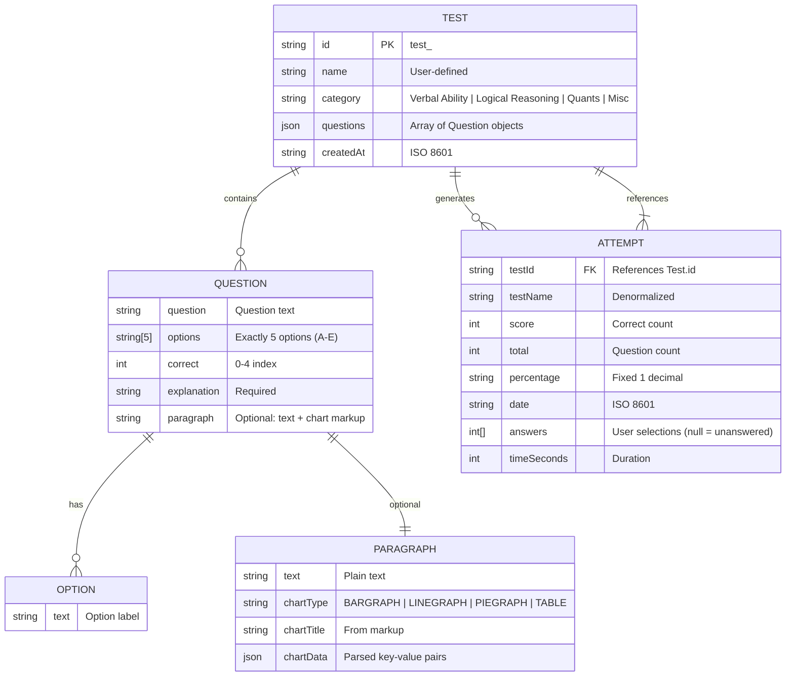

# CETPrep — Data Model

> Current schema version: **v3** (encoded in `cet_mock_tests_v3` key). No formal migrations — key suffix is the version.

---

## Entity Relationship Diagram



---

## Schema Definitions

### Test Object (stored in `cet_mock_tests_v3`)

```typescript
interface Test {
    id: string;                    // "test_" + crypto.randomUUID() or timestamp+random
    name: string;                  // User input, e.g., "RC Practice Set 1"
    category: 'Verbal Ability' | 'Logical Reasoning' | 'Quants' | 'Misc';
    questions: Question[];         // 1+ questions (validated)
    createdAt: string;             // ISO 8601, e.g., "2026-11-20T10:30:00.000Z"
}
```

**Storage**: `localStorage.getItem('cet_mock_tests_v3')` → `Test[]`

**Example**:
```json
{
  "id": "test_a1b2c3d4-e5f6-7890-abcd-ef1234567890",
  "name": "DI Practice - Charts",
  "category": "Quants",
  "questions": [...],
  "createdAt": "2026-11-20T10:30:00.000Z"
}
```

---

### Question Object (within Test.questions)

```typescript
interface Question {
    question: string;              // Required, non-empty
    options: [string, string, string, string, string];  // Exactly 5
    correct: 0 | 1 | 2 | 3 | 4;    // Index of correct answer
    explanation: string;           // Required, non-empty
    paragraph?: string;            // Optional; may contain chart markup
}
```

**Validation Rules** (from `validate.js`):
- Must be array with length ≥ 1
- Each question: `question` (string), `options` (array.length === 5), `correct` (0-4), `explanation` (string)
- `paragraph` if present: string; chart markup validated for numeric values

**Chart Markup Format** (in `paragraph`):
```
[BARGRAPH]          // or [LINEGRAPH], [PIEGRAPH], [TABLE]
Chart Title         // Title line
Label1: 120         // Data lines: "Key: Value"
Label2: 85
Label3: 200

// TABLE format:
[TABLE]
Table Title
Header1 | Header2 | Header3
Val1 | Val2 | Val3
Val4 | Val5 | Val6
```

---

### Attempt Object (stored in `cet_test_attempts`)

```typescript
interface Attempt {
    testId: string;                // References Test.id
    testName: string;              // Denormalized for display
    score: number;                 // Correct answers count
    total: number;                 // Total questions
    percentage: string;            // Fixed 1 decimal, e.g., "85.0"
    date: string;                  // ISO 8601 of submission
    answers: (number | null)[];    // User's selected indices; null = unanswered
    timeSeconds: number;           // Seconds elapsed
}
```

**Storage**: `localStorage.getItem('cet_test_attempts')` → `Attempt[]`

**Example**:
```json
{
  "testId": "test_a1b2c3d4...",
  "testName": "DI Practice - Charts",
  "score": 4,
  "total": 5,
  "percentage": "80.0",
  "date": "2026-11-20T10:45:30.000Z",
  "answers": [0, 2, null, 1, 3],
  "timeSeconds": 420
}
```

---

### Theme Preference (stored in `cetprep-theme`)

```typescript
type Theme = 'dark' | 'light';
```

**Storage**: `localStorage.getItem('cetprep-theme')` → `'dark' | 'light' | null`

---

## localStorage Keys (Immutable per PRD)

| Key | Version | Content Type | Max Est. Size |
|-----|---------|--------------|---------------|
| `cet_mock_tests_v3` | v3 | `Test[]` | ~500 KB (100 tests × 5 KB) |
| `cet_test_attempts` | v1 (implicit) | `Attempt[]` | ~1 MB (500 attempts × 2 KB) |
| `cetprep-theme` | v1 | `'dark' \| 'light'` | ~10 bytes |

**Total**: Well within 5-10 MB browser quota.

---

## PII Classification

| Entity | Fields | Classification | Rationale |
|--------|--------|----------------|-----------|
| **Test** | `name`, `category`, `questions[]` | **User-Generated Content** | No personal identifiers; user creates content |
| **Attempt** | `testId`, `testName`, `score`, `answers[]`, `timeSeconds` | **Behavioral / Performance Data** | Links to test but not to identity; no email, name, ID |
| **Theme** | `theme` | **Preference** | Anonymous preference |

**No PII/PHI stored** — no names, emails, IPs, device IDs, accounts.

---

## Retention Policy (As-Built)

| Data | Retention | Deletion Trigger |
|------|-----------|------------------|
| Tests | Indefinite | User clicks "Delete" per test |
| Attempts | Indefinite | User deletes parent test (cascades in `storage.js:23-27`) |
| Theme | Indefinite | User toggles theme (overwrites) |

**No automated cleanup** — manual only.

---

## Data Flow: Create → Attempt → Export

```mermaid
flowchart LR
    User[User] -->|1. Paste JSON| Create[Create Test Form]
    Create -->|2. Validate| Validate[validate.js]
    Validate -->|3. Save| Storage[storage.js:saveTest]
    Storage -->|4. Persist| LS_Tests[(cet_mock_tests_v3)]

    User -->|5. Click Attempt| TestPage[test.html?id=...]
    TestPage -->|6. Load Test| Storage2[storage.js:getTestById]
    Storage2 -->|7. Read| LS_Tests
    TestPage -->|8. User Answers| State[Alpine: answers[], marked[]]
    User -->|9. Submit| TestPage
    TestPage -->|10. Calculate Score| Results[resultsDetail, summary]
    TestPage -->|11. Save Attempt| Storage3[localStorage.setItem]
    Storage3 -->|12. Persist| LS_Attempts[(cet_test_attempts)]
    TestPage -->|13. Generate CSV| CSV[csv.js:generateCSV]
    CSV -->|14. Download| User
```

---

## Import Data Flow (GitHub → localStorage)

```mermaid
flowchart LR
    User[User] -->|1. Select Folder| Import[Import Page]
    Import -->|2. List Files| GH_API[GitHub API\n/contents/{folder}]
    GH_API -->|3. File List| Import
    User -->|4. Click Import| Import
    Import -->|5. Fetch JSON| GH_RAW[GitHub Raw\n/main/{folder}/{file}.json]
    GH_RAW -->|6. Question Array| Import
    Import -->|7. Map Category| Map[folderToCategory]
    Map -->|8. Create Test| Storage[storage.js:saveTest]
    Storage -->|9. Persist| LS_Tests[(cet_mock_tests_v3)]
    Import -->|10. Update UI| User
```

**Category Mapping** (hardcoded in `main.js:591-596`):
| GitHub Folder | CETPrep Category |
|---------------|------------------|
| `reading` | Verbal Ability |
| `vocab` | Verbal Ability |
| `di` | Quants |
| `lr` | Logical Reasoning |

---

## Known Data Quality Issues

| Issue | Location | Impact |
|-------|----------|--------|
| No schema version in Attempt | `cet_test_attempts` | Future migrations difficult |
| Denormalized `testName` in Attempt | `test.js:369` | Stale if test renamed (tests immutable after create) |
| `paragraph` mixing plain text + markup | `charts.js:312` | Parsing complexity; fragile |
| Chart data as strings in markup | `validate.js:37-42` | Runtime parse; no compile-time validation |
| `answers[]` uses `null` for unanswered | `test.js:41` | JSON serializes to `null`; OK |

---

## Migration History

| Version | Key | Change | Migration Strategy |
|---------|-----|--------|-------------------|
| v1 | `cet_mock_tests` | Initial | — |
| v2 | `cet_mock_tests_v2` | Schema change | Key rename (abandon v1) |
| v3 | `cet_mock_tests_v3` | Current | Key rename (abandon v2) |

**No forward migration code exists** — each version uses new key; old data orphaned.

---

## Related Documents

- [Architecture](architecture.md) — Module boundaries, flows
- [Integrations](integrations.md) — GitHub import data flow
- [Storage Module](03-development/codebase-tour.md#storagejs) — Implementation details
- [Data Classification](05-security/data-classification.md) — PII handling
- [Backup & DR](04-operations/backup-and-dr.md) — Manual backup via CSV