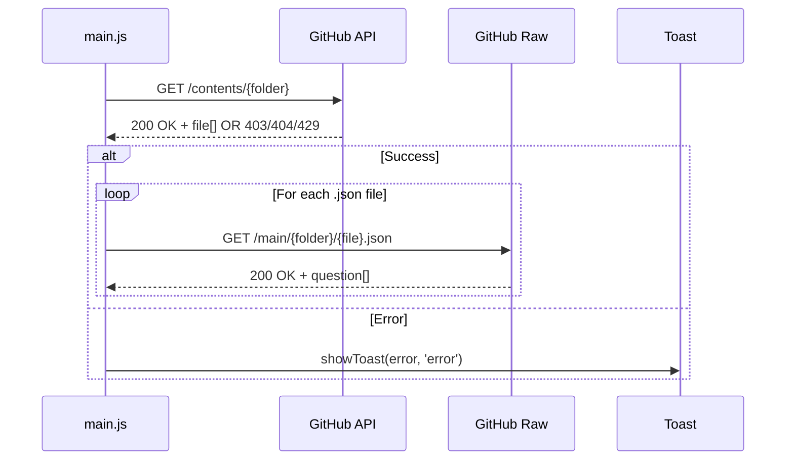
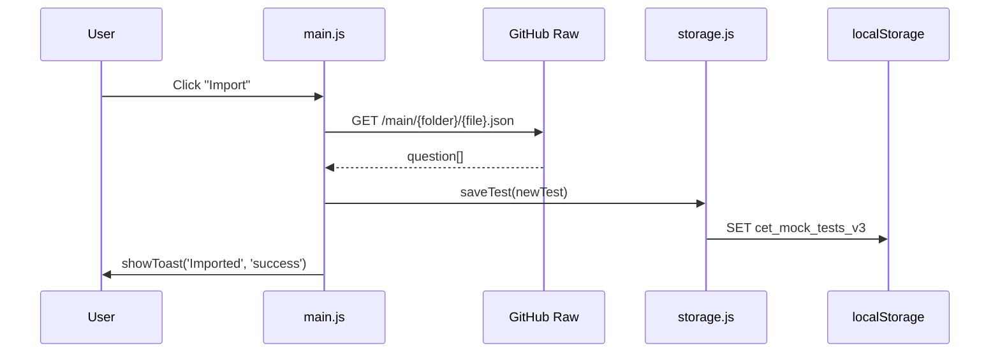
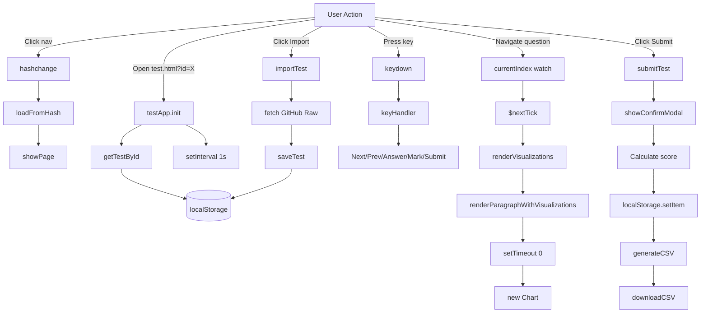

# CETPrep — Async Contracts & Events

> **No webhooks, no message queues, no event streaming**. This documents internal async flows and browser events.

---

## Async Contracts Summary

| Contract | Pattern | Delivery Guarantee | Retry | Dead Letter |
|----------|---------|-------------------|-------|-------------|
| GitHub API folder listing | `fetch` + `await` | Best-effort (60/hr) | None | Toast error |
| GitHub Raw file fetch | `fetch` + `await` | Best-effort | None | Toast error |
| localStorage read/write | Sync (`getItem`/`setItem`) | Immediate (or throw) | N/A | Silent fail |
| Chart.js render | `setTimeout(0)` + `$nextTick` | Next microtask | Retry loop (50ms) | Silent (empty container) |
| Timer tick | `setInterval` 1000ms | Best-effort (tab throttling) | N/A | N/A |
| CSV blob download | Sync blob + click | Immediate | N/A | N/A |

---

## Browser Events (Subscribed)

### `hashchange` — SPA Navigation (`index.html`)

```javascript
// main.js:228-230
window.addEventListener('hashchange', () => this.loadFromHash());
```

- **Trigger**: User clicks nav link (`href="#create"`) or browser back/forward
- **Payload**: `window.location.hash` (e.g., `"#tests"`)
- **Handler**: `loadFromHash()` → `showPage(hash)`
- **Idempotent**: Yes

### `beforeunload` — Unsaved Test Warning (`test.html`)

```javascript
// test.js:215-222
window.addEventListener('beforeunload', (e) => {
    if (!this.submitted) {
        e.preventDefault();
        e.returnValue = '';
    }
});
```

- **Trigger**: Tab close, refresh, navigation away
- **Condition**: `this.submitted === false`
- **Behavior**: Browser shows native "Leave site?" dialog
- **No custom message** (browsers ignore)

### `keydown` — Keyboard Shortcuts (`test.html`)

```javascript
// test.js:70-150
document.addEventListener('keydown', this.keyHandler);
```

- **Trigger**: Any key press (with guards)
- **Guards**: Ignore if `input/textarea/select` focused; ignore `ctrl/meta/alt`
- **Actions**: 20+ key mappings (see [ADR-008](01-architecture/decisions/adr-008-keyboard-shortcuts.md))
- **Cleanup**: `beforeunload` / component destroy removes listener

### `storage` (Cross-Tab Sync) — **NOT IMPLEMENTED**

```javascript
// NOT in codebase — gap
window.addEventListener('storage', (e) => {
    if (e.key === 'cetprep-theme') { /* sync theme */ }
});
```

- **Gap**: Theme changes in one tab don't propagate to other tabs
- **Impact**: Low (manual refresh works)

---

## GitHub API Async Flow

### Folder Listing (`loadFolderTests`)



- **Timeout**: None set (browser default ~300s)
- **Retry**: None (manual via folder reload button)
- **Concurrency**: `Promise.all` for `loadAllFolders()` (4 folders parallel)

### Single Test Import (`importTest`)



### Bulk Import (`importSelectedTests`)

- Sequential fetches (not parallel) to avoid rate limit burst
- Single `localStorage` write at end (atomic-ish)
- Partial success: reports `successCount` / `failCount` separately

---

## Chart Rendering Async Contract

### Trigger

`test.js:277-299` `renderVisualizations()` called on:
- Component init (after DOM ready)
- `currentIndex` change (`$watch` + `$nextTick`)
- `waitForParagraphBox` retry loop

### Contract

```javascript
// charts.js:394-398
setTimeout(() => {
    if (viz.type === 'bar') renderBarGraph(canvasId, viz.title, data);
    else if (viz.type === 'line') renderLineGraph(canvasId, viz.title, data);
    else if (viz.type === 'pie') renderPieChart(canvasId, viz.title, data);
}, 0);
```

- **Why `setTimeout(0)`**: Ensures `<canvas>` inserted into DOM before Chart.js measures it
- **`$nextTick`**: Alpine ensures DOM updated after `currentIndex` change
- **Retry**: `waitForParagraphBox` polls `requestAnimationFrame` until `#paragraphBox` exists

### Failure Modes

| Scenario | Behavior |
|----------|----------|
| Canvas not in DOM | `renderX` early-returns (checks `document.getElementById`) |
| Chart.js error | Uncaught → console error; chart blank |
| Destroy previous | `destroyChart(canvasId)` called first (Map lookup) |

---

## Timer Contract

```javascript
// test.js:224-231
startTimer() {
    this.timerInterval = setInterval(() => {
        if (!this.submitted) this.timeSeconds++;
    }, 1000);
}
```

- **Precision**: ~1 second (tab throttling in background tabs may delay)
- **Pause**: `this.submitted = true` stops increment
- **Cleanup**: `clearInterval` on submit / component destroy
- **Persistence**: Not saved — lost on refresh (by design)

---

## CSV Download Contract

```javascript
// csv.js:17-26
downloadCSV(content, filename) {
    const blob = new Blob([content], { type: 'text/csv;charset=utf-8;' });
    const link = document.createElement('a');
    link.href = URL.createObjectURL(blob);
    link.download = filename;
    document.body.appendChild(link);
    link.click();
    document.body.removeChild(link);
    setTimeout(() => URL.revokeObjectURL(link.href), 100);
}
```

- **Sync**: Immediate download trigger
- **Cleanup**: `revokeObjectURL` after 100ms
- **Filename**: `CETPrep_{TestName}_{YYYY-MM-DD}.csv`

---

## Event Flow Diagram



---

## Delivery Guarantees Summary

| Event/Flow | Guarantee | Notes |
|------------|-----------|-------|
| Hash navigation | At-least-once (idempotent) | Duplicate hash = no-op |
| Test load | Exactly-once (per open) | New tab = new load |
| Chart render | Best-effort | Retry loop; may show blank |
| Timer | Approximate | Background tab throttling |
| Attempt save | At-least-once | Duplicate possible on double-submit |
| Import | At-least-once per test | New ID each import |
| CSV download | Exactly-once | User-triggered |

---

## Related Documents

- [API README](README.md) — Auth, versioning, errors
- [Endpoints](endpoints.md) — Module interfaces
- [Architecture](01-architecture/architecture.md) — Sequence diagrams
- [Threat Model](05-security/threat-model.md) — STRIDE on async flows