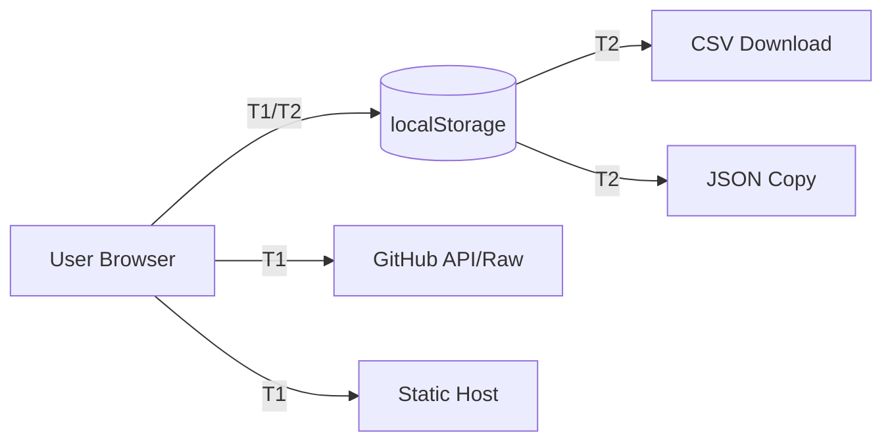

# CETPrep — Data Classification

> Classification of all data handled by the system. No backend — all data client-side.

---

## Classification Tiers

| Tier | Label | Description | Handling |
|------|-------|-------------|----------|
| **T1** | Public | Intended for public consumption | No restrictions |
| **T2** | Internal | Business data, not public | Access control, encryption at rest |
| **T3** | Confidential | PII, credentials, keys | Strict access, encryption, audit |
| **T4** | Restricted | PHI, financial, secrets | Highest protection, legal hold |

---

## Data Inventory

| Data Element | Tier | Location | PII? | Retention | Notes |
|--------------|------|----------|------|-----------|-------|
| **Test Questions** | T1 (Public) | localStorage, GitHub | No | User-controlled | User creates or imports |
| **Test Metadata (name, category)** | T1 | localStorage | No | User-controlled | — |
| **User Answers** | T2 (Internal) | localStorage | No | User-controlled | Study progress |
| **Attempt Scores** | T2 | localStorage | No | User-controlled | — |
| **Time Spent** | T2 | localStorage | No | User-controlled | — |
| **Marked for Review** | T2 | localStorage | No | User-controlled | — |
| **Theme Preference** | T1 | localStorage | No | User-controlled | — |
| **GitHub Test Content** | T1 | GitHub (external) | No | GitHub retention | Public repo |
| **Exported CSV** | T2 → T1 | User download | No | User-controlled | Contains answers |
| **Exported JSON** | T2 → T1 | User copy | No | User-controlled | Contains tests |

**No T3/T4 data exists** — no names, emails, IDs, payment, health data.

---

## PII Inventory

| PII Type | Present? | Where | Lawful Basis |
|----------|----------|-------|--------------|
| Name | ❌ | — | — |
| Email | ❌ | — | — |
| IP Address | ❌ | — | — |
| Device ID | ❌ | — | — |
| Location | ❌ | — | — |
| Biometric | ❌ | — | — |
| **Any direct identifier** | ❌ | — | — |

**Indirect identifiers**: None (no user accounts, no analytics with IDs).

---

## Data Flow Classification

**No data leaves browser except**:
1. GitHub API requests (public repo, no auth)
2. Static asset downloads (app code)
3. User-initiated CSV/JSON export

---

## Handling Rules by Tier

### T1 (Public)
- No encryption required
- Cacheable on CDN
- No access logging required
- No retention limit

### T2 (Internal - User Study Data)
- **At rest**: Browser localStorage (encrypted by browser profile)
- **In transit**: N/A (never leaves browser except user export)
- **Access**: User only (same-origin policy)
- **Retention**: Until user clears browser data
- **Deletion**: User clears site data / `localStorage.clear()`
- **Export**: CSV (per attempt), JSON (manual console)

---

## Data Subject Rights (GDPR/CCPA)

| Right | Supported? | Mechanism |
|-------|------------|-----------|
| **Access** | Partial | DevTools → localStorage view |
| **Rectification** | Yes | Edit test / re-attempt |
| **Erasure** | Yes | Clear site data / delete test |
| **Portability** | Partial | CSV per attempt; no bulk export |
| **Restriction** | N/A | No processing beyond user |
| **Objection** | N/A | No automated processing |
| **Automated Decision** | N/A | None |

**Gap**: No "Export All Data" or "Delete All Data" UI (see [Known Limitations](06-support/known-limitations.md)).

---

## Retention Policy

| Data | Retention | Deletion Trigger |
|------|-----------|------------------|
| Tests | Indefinite | User deletes test |
| Attempts | Indefinite | User clears history / site data |
| Theme | Indefinite | User toggles / clears site data |
| GitHub Cache | Session | Tab close (not persisted) |
| Build Artifacts | 30 days | CI artifact expiry |

**No automated retention enforcement** — user controls entirely.

---

## Encryption

| State | Algorithm | Key Management |
|-------|-----------|----------------|
| **In Transit (HTTPS)** | TLS 1.2/1.3 | Host managed (Netlify/Vercel/Cloudflare) |
| **At Rest (localStorage)** | Browser-managed (OS keychain) | OS / Browser profile |
| **At Rest (GitHub)** | GitHub-managed | GitHub |
| **At Rest (Static Host)** | Host-managed | Host |

**No application-level encryption** — relies on platform.

---

## Data Processing Agreements (DPAs)

| Processor | Purpose | DPA Status |
|-----------|---------|------------|
| **Static Host** (Netlify/Vercel/Cloudflare) | Serve static assets | Host-dependent |
| **GitHub** | Test content hosting | GitHub Terms |
| **Browser** | localStorage | N/A (user agent) |

**No backend processors** — no database, no analytics, no email, no payments.

---

## Incident Impact on Data

| Incident | Data Affected | Notification Required? |
|----------|---------------|------------------------|
| XSS exploit | localStorage read | Yes (if PII — but none) |
| Malicious deploy | localStorage write | Yes |
| GitHub repo compromise | Imported test content | No (public data) |
| Static host breach | App integrity | Yes (supply chain) |
| User clears browser | All user data | N/A (user action) |

---

## Related Documents

- [Threat Model](threat-model.md) — Asset classification
- [Authn/Authz](authn-authz.md) — Access control (none)
- [Secrets & Keys](secrets-and-keys.md) — Secret handling
- [Compliance Mapping](compliance-mapping.md) — Regulatory gaps
- [Known Limitations](06-support/known-limitations.md) — Data portability gaps