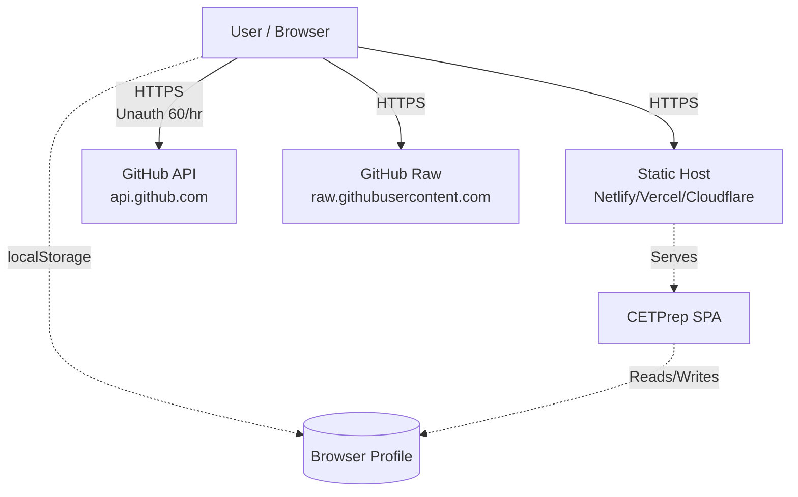

# CETPrep — Threat Model

> STRIDE analysis of the as-built system. No backend — attack surface is client-side only.

---

## System Context (C4 Level 1)



---

## Trust Boundaries

| Boundary | Description | Trust Level |
|----------|-------------|-------------|
| **User ↔ Browser** | User controls browser, extensions, DevTools | **Untrusted** (user is attacker) |
| **Browser ↔ Static Host** | HTTPS, static assets | **Trusted** (TLS + host) |
| **Browser ↔ GitHub API** | HTTPS, unauthenticated | **Semi-trusted** (rate limited, public data) |
| **Browser ↔ GitHub Raw** | HTTPS, public files | **Semi-trusted** (content from known repo) |
| **App ↔ localStorage** | Same-origin, user-accessible | **Untrusted** (user can modify) |

---

## Assets

| Asset | Classification | Location | Impact if Compromised |
|-------|----------------|----------|----------------------|
| **User Tests** | Internal | localStorage | Medium (study data loss) |
| **User Attempts** | Internal | localStorage | Medium (progress loss) |
| **User Theme** | Public | localStorage | None |
| **App Integrity** | Critical | Static Host + Browser | High (XSS → data theft) |
| **GitHub Test Content** | Public | GitHub | Low (public data) |
| **Session State** | Internal | Memory | Low (ephemeral) |

---

## STRIDE Analysis

### Spoofing

| Threat | Vector | Likelihood | Impact | Mitigation |
|--------|--------|------------|--------|------------|
| **T1: Fake GitHub Content** | Compromised `p3anv/mock-app-data` repo | Low | Medium (malicious questions) | Pin to commit hash; mirror data |
| **T2: Spoofed Static Host** | DNS hijack / CDN compromise | Very Low | High (full app control) | HSTS, CSP, subresource integrity |
| **T3: User Impersonation** | N/A (no auth) | N/A | N/A | No auth system to spoof |

### Tampering

| Threat | Vector | Likelihood | Impact | Mitigation |
|--------|--------|------------|--------|------------|
| **T4: localStorage Modification** | User edits DevTools → changes tests/attempts | High | Medium (data integrity) | Acceptable — user owns data |
| **T5: In-Transit Asset Modification** | MITM on static host | Very Low (HTTPS) | High | HTTPS enforced, HSTS |
| **T6: GitHub Raw Content Injection** | Repo maintainer pushes malicious JSON | Low | Medium | Review imports; mirror data |
| **T7: DOM XSS via `x-html`** | Malicious paragraph in imported test | Medium | High | Sanitize imported content (TD-005) |

### Repudiation

| Threat | Vector | Likelihood | Impact | Mitigation |
|--------|--------|------------|--------|------------|
| **T8: Deny Test Creation** | User claims didn't create test | High | Low | No audit log; localStorage only |
| **T9: Deny Attempt Submission** | User claims didn't take test | High | Low | No server record; CSV only local |

### Information Disclosure

| Threat | Vector | Likelihood | Impact | Mitigation |
|--------|--------|------------|--------|------------|
| **T10: localStorage Read by Extensions** | Browser extensions access storage | High | Low (study data) | No PII in tests |
| **T11: Referer Leakage to GitHub** | `fetch` sends Referer header | Medium | Low (public repo) | `referrerPolicy: 'no-referrer'` |
| **T12: Error Messages Leak Stack** | Uncaught errors in console | Medium | Low | Error boundary (TD-016) |
| **T13: Test Content in URL** | No — test.html uses `?id=` only | N/A | N/A | ID not sensitive |

### Denial of Service

| Threat | Vector | Likelihood | Impact | Mitigation |
|--------|--------|------------|--------|------------|
| **T14: GitHub Rate Limit** | 60/hr unauth → import broken | High | Medium | Token auth (TD-003); cache |
| **T15: localStorage Quota** | User fills quota → saves fail | Medium | High (silent loss) | Quota check + toast (TD-002) |
| **T16: Large Test OOM** | 1000+ questions → Chart.js crash | Low | Medium | No hard limit; validate.js |
| **T17: Malicious CSV Download** | Large blob → browser hang | Low | Low | Blob size limited by data |

### Elevation of Privilege

| Threat | Vector | Likelihood | Impact | Mitigation |
|--------|--------|------------|--------|------------|
| **T18: XSS → localStorage Access** | T7 exploited → read all storage | Medium | High | CSP, sanitize, no `x-html` user data |
| **T19: Prototype Pollution** | Malicious JSON `constructor` | Low | Medium | `JSON.parse` safe; no `eval` |
| **T20: Supply Chain** | Compromised npm package | Low | Critical | Lockfile, Dependabot (TD-013) |

---

## Attack Trees

### Goal: Steal User's Test Data

```
Steal Test Data
├── Read localStorage directly (User/Extension) → ALWAYS POSSIBLE
├── XSS via imported paragraph
│   ├── Import malicious test from GitHub
│   │   ├── Compromise p3anv/mock-app-data repo
│   │   └── Trick user to import local malicious JSON
│   └── Execute via x-html in paragraph rendering
├── XSS via themeIcon (main.js:304)
│   └── Requires themeIcon to become user-controlled → NOT CURRENTLY
└── Supply chain attack on Chart.js/Alpine/PapaParse
    └── Compromised npm package → runtime code execution
```

### Goal: Corrupt User's Attempt History

```
Corrupt Attempts
├── Direct localStorage edit (User) → ALWAYS POSSIBLE
├── XSS → programmatic localStorage write
│   └── Same vectors as data theft
└── Race condition on submit
    └── Double-click submit → duplicate attempt → NOT EXPLOITABLE
```

---

## Mitigation Summary

| Mitigation | Threats Addressed | Status |
|------------|-------------------|--------|
| HTTPS + HSTS | T2, T5 | ✅ (host dependent) |
| CSP Header | T7, T18 | ❌ (TD-011) |
| GitHub Token Auth | T14 | ❌ (TD-003) |
| Import Sanitization | T6, T7 | ❌ (TD-005) |
| Quota Check + Toast | T15 | ❌ (TD-002) |
| Error Boundary | T12 | ❌ (TD-016) |
| Dependabot + Lockfile | T20 | ❌ (TD-013) |
| Commit Pin for GitHub Data | T1, T6 | ❌ (TD-015) |
| Referrer Policy | T11 | ❌ (easy add) |
| `referrerPolicy: 'no-referrer'` on fetch | T11 | ❌ (easy add) |

---

## Residual Risk (Accepted)

| Risk | Reason | Monitoring |
|------|--------|------------|
| User modifies own localStorage | User owns browser; no server auth | None |
| GitHub repo compromised | Low likelihood; public data | Manual watch |
| No audit trail | No backend; by design | None |
| XSS via `x-html` (trusted sources only) | Current sources trusted; TD-005 tracks | Code review |

---

## Security Testing (Not Done)

| Test | Tool | Frequency |
|------|------|-----------|
| SAST | GitHub CodeQL | Per PR (not enabled) |
| DAST | OWASP ZAP | Pre-release (not done) |
| Dependency Scan | `npm audit` / Dependabot | Manual (TD-013) |
| CSP Evaluation | CSP Evaluator | Not done |
| Penetration Test | Manual | Never |

---

## Related Documents

- [Authn/Authz](authn-authz.md) — Identity model (none)
- [Data Classification](data-classification.md) — Asset classification
- [Secrets & Keys](secrets-and-keys.md) — Secret management
- [Supply Chain](supply-chain.md) — Dependency risk
- [Compliance Mapping](compliance-mapping.md) — Control gaps
- [Tech Debt Register](03-development/tech-debt-register.md) — TD-002, TD-003, TD-005, TD-011, TD-013, TD-015, TD-016, TD-020